# EasySave UI 设计规范（视觉参考：`docs/design/` 原型截图）

> 截图只作为视觉参考，不要求像素级还原。**一切以本文件的修改意见为准。**
> App 名称统一为 **EasySave**（Grabit 为备选，定名前全文暂用 EasySave）。
> 删除所有"原型版本"提示文字。支持深色模式（由以下浅色 token 推导，保持暖色调）。

## 1. 设计 Token（可直接映射到 Flutter `ThemeData`）

色值来自截图像素取样，以此为准。

### 1.1 颜色

| Token | 浅色值 | 深色值（暖色调推导） | 用途 / 映射 |
|---|---|---|---|
| `background` | `#FAF6F1`（暖米色） | `#1A1412` | `scaffoldBackgroundColor` |
| `surface`（卡片） | `#FFFFFF` | `#26201C` | 卡片底；**用柔和阴影，不用边框** |
| `cardShadow` | `Black` 8% + blur 16 + offset (0, 4) | `Black` 40% + blur 16 | 卡片 `BoxShadow` |
| `gradientStart` | `#FC494C` | `#FC494C` | 主按钮渐变起始 |
| `gradientEnd` | `#FA662E` | `#FA662E` | 主按钮渐变结束（`LinearGradient([#FC494C, #FA662E])`，横向） |
| `primary` | `#EA3B48` | `#F26A75` | `colorScheme.primary`；选中边框、勾选、底部导航选中项 |
| `secondaryBgPink` | `#FFDCD7` | `#4A2622` | 次级按钮底、粉色浅底 |
| `secondaryBgBeige` | `#F3E9E1` | `#33291F` | 识别提示条、"原帖"等次要按钮底 |
| `textPrimary` | `#1E130F`（暖黑） | `#F5ECE6` | `colorScheme.onSurface` |
| `textSecondary` | `#A89B92`（暖灰） | `#8D7F76` | `colorScheme.onSurfaceVariant`；作者、时间、副文案 |
| `success` | `#43A047` | `#66BB6A` | 下载完成、已登录 |
| `warning` | `#FB8C00` | `#FFA726` | 部分失败提示 |
| `error` | `#EA3B48` | `#F26A75` | `colorScheme.error`；失败项标红、删除 |
| `platformXhs` | `#EA1C42` 纯色 | 同左 | 小红书标签底色（白字） |
| `platformIg` | `#CE35A8` 纯色 | 同左 | Instagram 标签底色（白字） |
| `platformX` | `#0F1419` 纯色 | 同左 | X (Twitter) 标签底色（白字） |
| `overlayScrim` | `Black54` | `Black54` | 全屏查看、下载面板遮罩 |
| `overlayFullscreen` | `#12100E`（暖黑全屏背景） | `#000000` | 全屏浏览器沉浸式背景 |
| `toolbarActiveBg` | `#FFDCD7` | `#4A2622` | 激活状态的工具栏小图标按钮底色 |
| `badgeBgDark` | `rgba(0, 0, 0, 0.6)` | `rgba(0, 0, 0, 0.7)` | 缩略图/卡片半透明深色角标（多图 `❐ N`、视频时长 `▶ 00:14`） |
| `badgeBgWhite` | `#FFFFFF` | `#F5ECE6` | 浅色角标底（`LIVE`、`GIF` 角标），白底黑字 |

### 1.2 形状与阴影

| Token | 值 | 映射 |
|---|---|---|
| `radiusCard` | 24 | 大卡片（确认卡片、历史卡片、列表行）`BorderRadius.circular(24)` |
| `radiusButton` | 胶囊（`StadiumBorder`） | 主按钮：红→橙渐变底 + 白字；次级按钮：米色/粉色胶囊 |
| `radiusThumb` | 16 | 预览缩略图、列表缩略图 `ClipRRect(borderRadius: 16)` |
| `radiusCardWaterfall` | 20 | 瀑布流卡片 `ClipRRect(borderRadius: 20)` |
| `toolbarButtonSize` | 34 × 34（图标 18） | 历史页顶部工具栏紧凑小图标按钮 |
| `elevationCard` | 柔和阴影（见 `cardShadow`），无边框 | 所有白色卡片 |
| `stackedCardShadow` | `Black` 10% + blur 8 + offset (0, 4) + 多重下沉边阶 | 瀑布流多图卡片底部轻微叠层卡片阴影 |
| `elevationSheet` | 16 + `Black26` scrim | 下载面板、删除确认面板（`showModalBottomSheet`） |

### 1.3 字号层级（Material 3 TypeScale 映射）

| Token | 字号/字重 | 映射 | 用途 |
|---|---|---|---|
| `titleLarge` | 20 / w600 | `textTheme.titleLarge` | AppBar 标题（作者名/帖子标题） |
| `titleMedium` | 16 / w600 | `textTheme.titleMedium` | 卡片标题、面板标题 |
| `bodyMedium` | 14 / w400 | `textTheme.bodyMedium` | 正文、文案区 |
| `bodySmall` | 12 / w400 | `textTheme.bodySmall` | 作者、时间、副文案 |
| `labelSmall` | 11 / w600 | `textTheme.labelSmall` | 平台标签、角标（视频时长、Live） |

### 1.4 间距

8pt 基准：页面边距 16，卡片内边距 16~20（大圆角需要更宽松的内边距），列表项间距 12，网格间距 8。预览网格 `crossAxisCount: 2`。

### 1.5 平台标签样式

白字小胶囊（圆角 8~10，11sp 加粗）：小红书 `#EA1C42` 纯色，Instagram `#CE35A8` 纯色，X (Twitter) `#0F1419` 纯色。出现在历史卡片、预览页 AppBar 副标题、下载面板标题旁。

## 2. 逐页布局与组件

### 2.1 首页（Tab 1：解析）

- 顶部：**渐变色头图区**（`gradientStart → gradientEnd`，高度约 180），上面叠一张白色大圆角卡片（`radiusCard` 24 + 柔和阴影，负边距 overlapping 头图底部）。
- 卡片内：输入框（surface 底，圆角 16），**右侧放粘贴图标按钮**（`Icons.paste`）；**去掉独立的"读取剪贴板"按钮**。
- **剪贴板自动检测**：打开 App（`initState` + `AppLifecycleState.resumed`）时读剪贴板，若含支持链接则弹出**确认卡片**（对话框样式：链接 + 平台标签 + [解析] [取消]）。
- **解析中状态**：输入框下方或全屏小卡片显示 `CircularProgressIndicator` + "解析中…" + **[取消]按钮**（取消 headless WebView 解析任务）。
- **解析失败状态**：红色错误卡片，按 §4 错误码显示文案和操作按钮（如 LOGIN_REQUIRED → [去登录]）；卡片上带**诊断按钮**（复制诊断信息，预览页 AppBar 不再放）。
- 下半部分：**最近 3 条历史**（缩略图全部读取本地文件，不再使用 CDN 地址以防签名过期裂图；通过 `photo_manager` 按"相册名 + 文件名"定位，点击整行直接进入统一全屏浏览器的本地文件模式，见 §2.6；保持现有简洁列表样式，**不加左滑和长按手势**），尾部"查看全部 →"跳历史页。

### 2.2 预览页

- AppBar：作者名 + 平台标签；**无诊断按钮**（诊断入口只在错误卡片上）。
- 标题下方：**可折叠文案区**（`ExpansionTile`：标题 + 正文，默认折叠）+ **"复制文案"按钮**（复制"标题 + 正文"拼接文本）。
- 网格：**2 列**缩略图，圆角 16；**视频显示右下角标（▶ + 时长 `mm:ss`，时长取自 item.duration，取不到只显示 ▶）**；**Live 图显示 "Live" 标识**（左上角小胶囊）；**GIF 显示 "GIF" 标识**。
- 交互：**选中项主色描边 + 右上角圆形勾选 + 左下角"1/3"序号**（序号 = 选中顺序）；**点勾选框切换选择，点图片本身打开统一全屏浏览器组件**（见 §2.6，远程媒体模式，左右滑动切换，视频自播，Live 图长按播放，GIF 自动循环，右上角勾选框与页面选择状态实时双向同步）。
- 底部：全选/反选 + [保存到相册] 主按钮（红→橙渐变胶囊，白字）。

### 2.3 下载面板（Modal Bottom Sheet）

- 条目命名：**图片 1、图片 2… / 视频 / Live 1、Live 2… / GIF 1、GIF 2…**（按类型独立计数）。
- 每行：缩略图 + 名称 + 状态（等待/下载中百分比/完成✓/失败标红）。
- 底部按钮：**[后台下载]**（原"稍后继续"改名，切后台不中断，v1.1b）+ **[取消]按钮**（原垃圾桶图标改为文字按钮，取消未完成任务）。
- **完成状态**：顶部"全部完成 ✓" + [打开相册] [分享] [完成]（[打开相册] 用 `Gal.open()` 实现，已核实 gal 2.3.3 提供该 API；分享为 v1.2 功能，先置灰或隐藏）。
- **部分失败状态**：顶部 warning 色"X 项失败"，**失败行标红 + 单独 [重试] 按钮**；单个文件失败不导致整批报错。

### 2.4 历史页（Tab 2：历史）

（视觉原型交互细节以 [docs/design/gallery-prototype/](file:///d:/workspace/IdeaProjects/EasySave/docs/design/gallery-prototype/) 为准）

#### 2.4.1 页面头部与视图切换（帖子 / 全部 / 创作者）

- 顶部信息：页面主标题"历史"（`titleLarge`），副标题动态统计文本（如 "8 个帖子 · 30 个文件"，`bodySmall textSecondary`）。
- 视图切换栏：药丸形切换胶囊容器（浅米色 `secondaryBgBeige`），提供三段切换：
  1. **帖子**（默认）：按帖子聚合展示，支持瀑布流和列表两种布局，**切换后记住用户的布局偏好**（持久化至本地偏好）。
  2. **全部**：所有帖子的媒体打散平铺成连续瀑布流，单文件粒度纯粹浏览。
  3. **创作者**：按创作者聚合，每个作者展示 2x2 四宫格封面，点击后进入帖子视图并带上该作者的筛选。
- **生效筛选指示**：当平台筛选或作者筛选生效时，在视图切换栏右侧以可点击清除的小标签（Chip，带 `✕` 图标）显示，点击即可一键清除对应筛选。
- **相册权限提示条**：未获得相册读取权限时，在页面顶部（视图切换栏上方）显示提示条"**授权相册访问后可显示缩略图**"，点击"授权"请求权限；Android 14 部分授权（limited）显示"仅授权了部分照片，未授权的媒体无法显示 / 管理权限"；永久拒绝显示"未获得相册权限，无法定位本地文件 / 去设置"。授权后提示条自动消失。

#### 2.4.2 紧凑工具栏与弹出菜单

- 工具栏位于页面右上角，仅使用紧凑小图标按钮（尺寸约 34px × 34px，内部图标 18px）：
  1. **搜索**（`Icons.search`）：展开/收起搜索输入框。
  2. **平台筛选**（`Icons.filter_list` 或漏斗图标）：点击弹出平台小菜单（全部 / 小红书 / Instagram / X (Twitter)）。
  3. **排序**（`Icons.swap_vert`）：点击弹出排序方式小菜单。
  4. **布局切换**（**仅在帖子视图显示**，全部与创作者视图隐藏）：瀑布流状态显示列表图标，列表状态显示网格图标。
- **高亮状态**：当某个工具栏按钮有非默认或生效中的条件（如处于搜索状态、非全部平台筛选、非默认排序）时，图标按钮呈现浅粉色圆形高亮背景（`toolbarActiveBg` `#FFDCD7` / 深色 `#4A2622`）。

#### 2.4.3 帖子视图：瀑布流卡片规范

参考原型：[瀑布流.png](file:///d:/workspace/IdeaProjects/EasySave/docs/design/gallery-prototype/瀑布流.png)

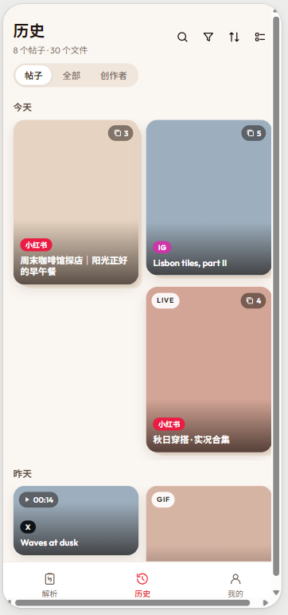

- 布局：2 列交错瀑布流（`MasonryGridView`），卡片圆角 `radiusCardWaterfall`（20px），间距 8px。
- 封面比例：卡片封面**严格保持首图原始比例**自适应展示。
- 多图帖子标识：
  - 卡片右上角显示深色半透明圆角胶囊（`badgeBgDark`），内含多图图层图标与总张数（如 `❐ 3`、`❐ 5`）。
  - 卡片底部带有多重层次感微弱下沉阴影（`stackedCardShadow`），在视觉上呈现叠层卡片效果。
- 视频帖子标识：角标显示深色半透明胶囊，内含播放三角与时长（如 `▶ 00:14`），无时长时仅显示 `▶`。
- Live 图帖子标识：卡片左上角显示白底黑字胶囊 `LIVE`（`badgeBgWhite`）；多图帖子右上角仍叠加张数胶囊。
- GIF 帖子标识：卡片左上角显示白底黑字胶囊 `GIF`（`badgeBgWhite`）。
- 底部渐变遮罩与信息：
  - 卡片底部覆盖黑色线性渐变遮罩（`LinearGradient(colors: [transparent, Black87])`）。
  - 遮罩上方浮现平台标签胶囊（小红书 / IG / X）与白色粗体标题（`bodyMedium w600`，最多 2 行，尾部省略）。
- 交互：点击整张卡片使用 Hero 共享元素过渡动画展开全屏浏览器（本地文件模式）。

#### 2.4.4 帖子视图：列表行规范

参考原型：[列表.png](file:///d:/workspace/IdeaProjects/EasySave/docs/design/gallery-prototype/列表.png)

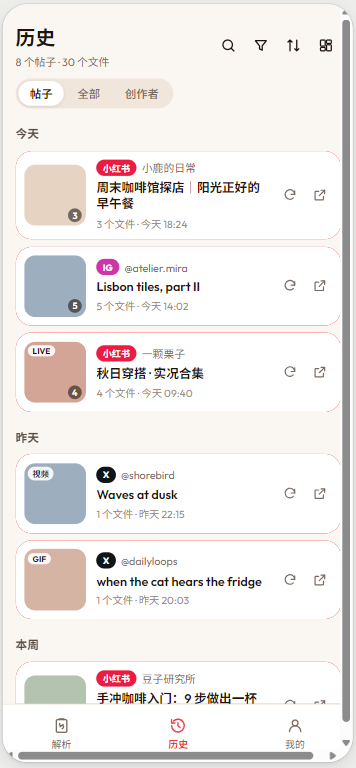

- 布局：垂直单列卡片流，每项为白色大圆角表面卡片（`radiusCard` 24，柔和阴影，内边距 12~16）。
- 左侧本地缩略图：
  - 方形圆角容器（约 76px × 76px，圆角 16），优先读取本地系统相册文件缩略图。
  - 多图帖子在缩略图右下角显示张数徽标圆点（如 `3`、`5`）。
  - 视频/Live/GIF 在缩略图左上角显示白色胶囊角标（`视频`、`LIVE`、`GIF`）。
- 中间文本信息：
  - 首行：平台胶囊标签（白字纯色）+ 作者名称（`bodySmall textSecondary`）。
  - 中行：帖子标题（`titleMedium / bodyMedium w600 textPrimary`，最多 2 行）。
  - 底行：文件数量统计与相对/绝对保存时间（如 "3 个文件 · 今天 18:24"，`bodySmall textSecondary`）。
- 右侧轻量操作区：垂直居中放置 2 个紧凑小图标按钮（尺寸 32px，图标 16px，点击不触发整行跳转）：
  1. **重新解析**（`Icons.refresh`）：后台重新抓取原帖数据，解析完成后直接进入预览页。
  2. **打开原帖**（`Icons.open_in_new`）：调用外部系统浏览器或对应平台 App 打开原帖。
- 交互：点击列表卡片整行（除右侧 2 个独立小按钮外）进入全屏浏览器。

#### 2.4.5 全部视图（All Media）

参考原型：[全部模式.png](file:///d:/workspace/IdeaProjects/EasySave/docs/design/gallery-prototype/全部模式.png)

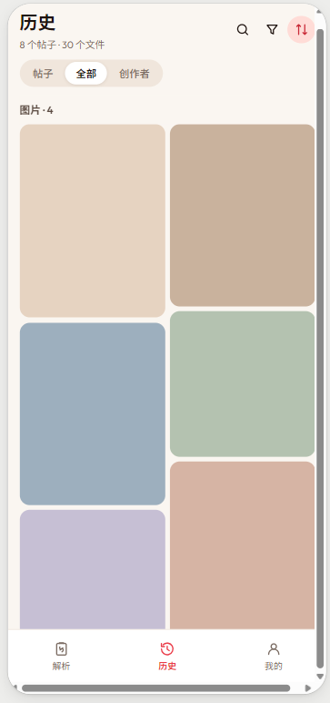

- 核心定位：将所有帖子的媒体打散，平铺成单文件维度的连续瀑布流。
- 视觉纯净度：卡片不显示帖子标题、不叠加暗色渐变与平台标签，聚焦纯粹的媒体浏览体验。
- 工具栏调整：右侧工具栏自动隐藏"布局切换"按钮（固定为瀑布流）。
- 交互：点击单个媒体直接以该文件作为初始索引打开全屏浏览器。

#### 2.4.6 创作者视图（Creators）

参考原型：[创作者模式.png](file:///d:/workspace/IdeaProjects/EasySave/docs/design/gallery-prototype/创作者模式.png)

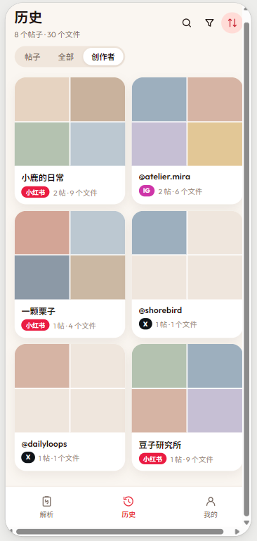

- 核心定位：按作者（Author）聚合展示历史帖子。
- 卡片结构：
  - 2 列网格卡片，顶部为 2x2 四宫格封面（提取该创作者最新保存的最多 4 个媒体本地缩略图，不足 4 个展示浅米色纯色占位框），圆角 20。
  - 底部文本区：作者名称（加粗粗体），平台胶囊标签 + "X 帖 · Y 个文件"。
- 工具栏调整：右侧工具栏自动隐藏"布局切换"按钮。
- 交互：点击创作者卡片立即切到"帖子"视图，同时在视图切换栏右侧注入该作者的筛选小标签，列表仅展示该作者的帖子。

#### 2.4.7 排序与分组逻辑

参考原型：[排序_类型.png](file:///d:/workspace/IdeaProjects/EasySave/docs/design/gallery-prototype/排序_类型.png)

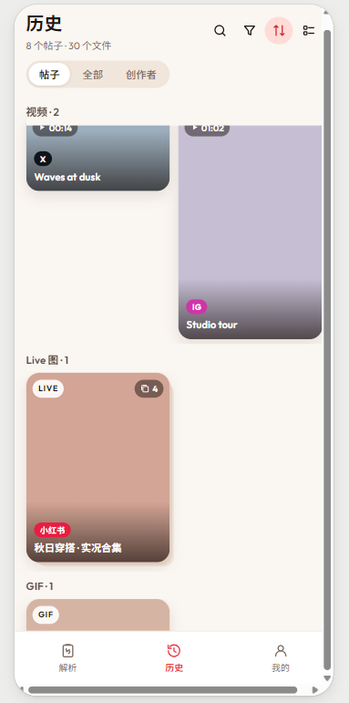

- 排序菜单项及分组规则：
  1. **最新保存**（默认）：按保存时间倒序；**按日期分组**（"今天"、"昨天"、"本周"、"2026-10-12"），日期分组标题吸顶（Sticky Header）。
  2. **最早保存**：按保存时间正序；**按日期分组**，日期分组标题吸顶。
  3. **按类型**：按媒体类型分组展示（图片 / 视频 / Live 图 / GIF），**组标题带数量统计**（如 "视频 · 2"、"Live 图 · 1"、"GIF · 1"、"图片 · 4"），标题吸顶。
  4. **文件最多**：按帖子包含的文件数从多到少排序，平铺排列，**不分组**。
  5. **按作者**：按创作者名称拼音/字母排序，平铺排列，**不分组**。

#### 2.4.8 搜索交互与生效筛选小标签

参考原型：[搜索.png](file:///d:/workspace/IdeaProjects/EasySave/docs/design/gallery-prototype/搜索.png)

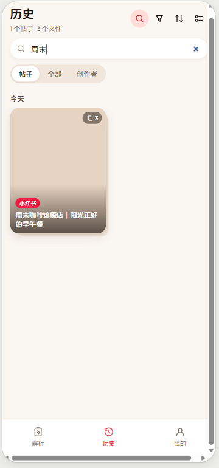

- 搜索展开：点击工具栏搜索小图标，在顶部栏下方平滑推开搜索输入框（`surface` 浅底，圆角 16，左侧放大镜图标，中间文本输入，右侧 `✕` 清除按钮）。
- 实时过滤：输入文本实时按**标题（Title）和作者（Author）**进行本地模糊匹配。
- 动态结果反馈：页面标题下方统计副文案实时更新为当前匹配结果数量（如 "1 个帖子 · 3 个文件"）。
- 生效筛选指示：当有平台筛选（如小红书、Instagram、X）或创作者筛选处于生效状态时，在三段视图切换栏右侧显示可点击清除的小 Chip，点击后清除该筛选。

#### 2.4.9 删除交互与左滑操作

参考原型：[左滑删除.png](file:///d:/workspace/IdeaProjects/EasySave/docs/design/gallery-prototype/左滑删除.png)

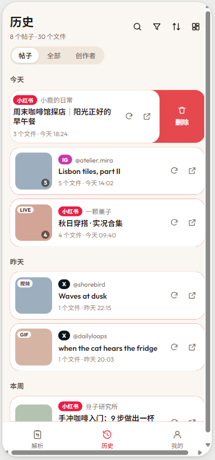

- **左滑手势限制**：**仅列表行支持左滑**显示红色删除操作块；**瀑布流卡片和"全部"视图明确不支持左滑**，避免左右手势与垂直瀑布流滚动冲突。
- 左滑露出区：向左滑动单行卡片，露出右侧红色操作区（垃圾桶图标 + "删除"文字）。点击红色删除块呼出删除确认面板。

#### 2.4.10 多选模式规范

参考原型：[多选模式_瀑布流.png](file:///d:/workspace/IdeaProjects/EasySave/docs/design/gallery-prototype/多选模式_瀑布流.png)、[多选模式_列表.png](file:///d:/workspace/IdeaProjects/EasySave/docs/design/gallery-prototype/多选模式_列表.png)

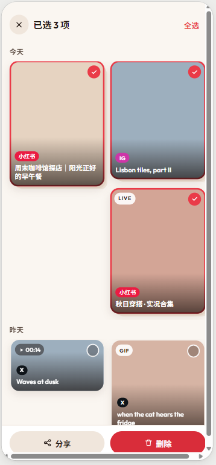
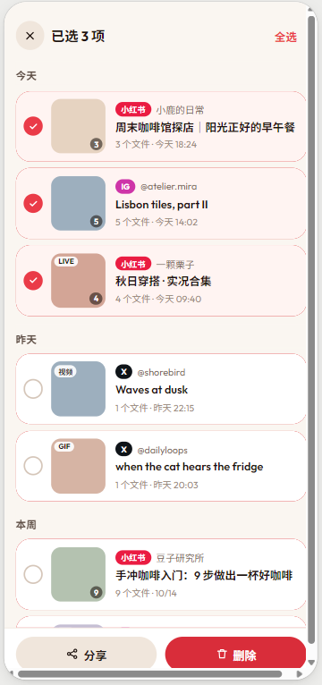

- **触发方式**：长按任意卡片或列表行进入多选模式（伴随触感振动反馈）。
- **顶部 AppBar 替换**：
  - 左侧：圆形 `✕` 图标按钮，点击退出多选模式。
  - 中间：粗体显示当前选中数量（"已选 N 项"）。
  - 右侧：文字按钮"全选"（若已全部选中则变为"取消全选"）。
- **卡片/行形态变换**：
  - 瀑布流视图：选中项卡片显示主色（`primary` 红色）外描边 + 右上角红色实心对勾标记 `✓`；未选中项右上角显示半透明白色空心圆圈。
  - 列表视图：每行卡片左侧滑出圆形勾选框（选中为红底白勾 `✓`，未选为米色空心圆圈）；右侧原有的"重新解析"和"打开原帖"小按钮自动隐藏。
- **底部操作栏替换**（覆盖原底部导航）：
  - 帖子视图：左侧 [分享]（浅米色胶囊，分享选中帖子的文件与文案）+ 右侧 [删除]（红色胶囊，弹出删除确认面板）。
  - 全部视图：按单个文件多选，底部**只提供 [分享] 按钮**，不提供批量删除。

#### 2.4.11 删除确认面板（Modal Bottom Sheet）

参考原型：[删除确认面板.png](file:///d:/workspace/IdeaProjects/EasySave/docs/design/gallery-prototype/删除确认面板.png)

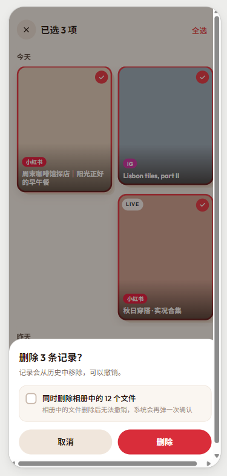

- 弹出时机：列表行左滑点击删除、或多选模式点击底部 [删除] 按钮时触发。
- 面板内容：
  - 标题："删除 N 条记录？"（`titleMedium w600`）。
  - 提示说明："记录会从历史中移除，可以撤销。"（`bodySmall textSecondary`）。
  - 附加选项卡片（米色浅底圆角卡片 `secondaryBgBeige`，圆角 16）：
    - 复选框："同时删除相册中的 M 个文件"（**默认不勾选**）。
    - 辅助说明："相册中的文件删除后无法撤销，系统会再弹一次确认"。
  - 底部操作按钮组：左侧 [取消]（浅米色胶囊）与右侧 [删除]（红色胶囊）。
- 执行与撤销逻辑：
  - **默认未勾选"同时删除相册文件"**：
    - 仅从 SQLite 数据库移除历史记录；
    - 移出后页面底部弹出 SnackBar："已删除 N 条记录，可以撤销 [撤销]"；
    - 点击 [撤销] 按钮可立即恢复记录，无缝插回原位。
  - **勾选"同时删除相册中的 N 个文件"**：
    - **明确不支持撤销**；
    - 调用 Android `MediaStore.createDeleteRequest` 接口唤起系统原生确认弹窗；
    - **用户在系统弹窗中同意**：系统执行相册物理文件删除，App 删除本地数据库记录；
    - **用户在系统弹窗中拒绝**：相册文件保持完好，App 仅删除历史记录，并弹出提示条："相册文件已保留，仅删除历史记录"。

#### 2.4.12 边缘与异常状态规范

- **"已从相册删除" 占位与重新下载**：
  - 定位机制：引入 `photo_manager`，按"相册名 + 文件名"在系统相册中检索已保存文件，检索成功后缓存媒体 ID。
  - 占位样式：当文件已被用户在系统相册中物理删除导致定位失败时，对应卡片缩略图或全屏视图显示灰色占位背景 + 破损图片图标 + "已从相册删除"文案。
  - 恢复操作：占位区域提供 [重新下载] 按钮，点击后根据记录中保存的媒体链接重新拉取并存入相册，恢复缩略图并更新本地缓存 ID。
- **空状态**：
  - 全局历史为空：显示插图占位 + "还没有下载记录，去首页解析第一条帖子吧" + [去解析] 主按钮。
  - 搜索/条件筛选结果为空：显示无结果插图/图标 + "没有找到匹配的记录" + [清除筛选] 次级按钮，点击重置所有生效中的筛选与搜索条件。

### 2.5 我的页（Tab 3：我的）

分三组（`ListView` + 分组头）：

1. **账号**：平台行（小红书 / Instagram）显示登录状态（已登录 + 昵称 / 未登录）；[退出登录]（二次确认）；**登录过期提示**（解析报 LOGIN_REQUIRED 时对应行显示 warning 色"登录已过期，请重新登录"）。
2. **下载设置**：相册名称、文件名格式、同时保存文案为 txt、自动检测剪贴板开关（roadmap v1.1a）、**悬浮球快捷入口开关**（roadmap v1.6，默认关闭；开启时引导授予"显示在其他应用上层"权限，权限被撤销时开关自动关闭）。
3. **其他**：清除缓存、版本号、（可选）意见反馈、开源许可。

### 2.6 统一全屏浏览器组件（预览页与历史页共用）

（视觉原型交互细节以 [docs/design/gallery-prototype/](file:///d:/workspace/IdeaProjects/EasySave/docs/design/gallery-prototype/) 为准）

参考原型：[全屏浏览.png](file:///d:/workspace/IdeaProjects/EasySave/docs/design/gallery-prototype/全屏浏览.png)、[全屏浏览_gif.png](file:///d:/workspace/IdeaProjects/EasySave/docs/design/gallery-prototype/全屏浏览_gif.png)、[全屏浏览_live.png](file:///d:/workspace/IdeaProjects/EasySave/docs/design/gallery-prototype/全屏浏览_live.png)

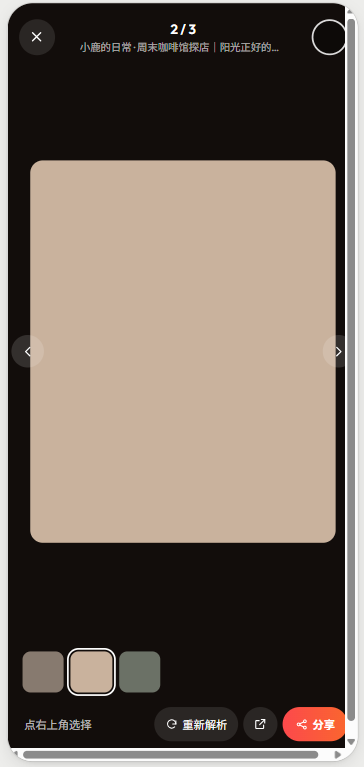
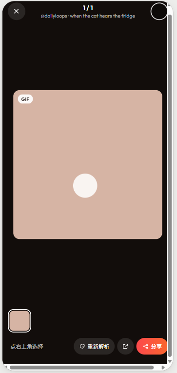
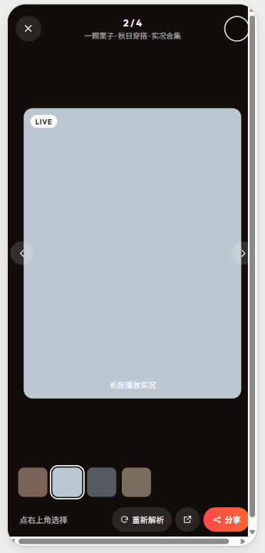

- 组件定位：作为统一的全屏媒体查看器，被**预览页（远程网络媒体模式）**与**历史页 / 解析首页最近（本地相册媒体模式）**双向复用。
- 背景与沉浸感：沉浸式深黑/暖黑背景（`overlayFullscreen` `#12100E` / `#000000`）。
- **相册权限提示**：本地相册模式（历史页 / 最近）下，未获得相册读取权限时，顶部控制栏下方显示浅色提示条"授权相册访问后可显示本地原图"，点击"授权"请求权限（含 Android 14 部分授权）；授权后自动消失。

#### 2.6.1 顶部浮层控制栏

- 左侧：圆形半透明深色关闭按钮（`✕`，点击或下拉退出全屏）。
- 中间：
  - 上行：当前序号 / 总数（如 "2 / 3"、"1 / 1"、"2 / 4"，加粗大字）。
  - 下行：创作者昵称 · 帖子标题（白色细字，超出截断）。
- 右侧：圆形勾选框，**选择状态与外部页面（预览页选中状态或历史页多选状态）实时双向同步**。

#### 2.6.2 核心手势与过渡动画

- **左右滑动**：水平滑动手势平滑切换上一张/下一张媒体，两端带弹性回弹。
- **双指缩放**：基于 `PhotoView` 或 `InteractiveViewer`，支持双指自由缩放与双击放大/复原。
- **下滑关闭**：支持垂直下拉手势，带有拖拽阻尼感与背景透明度渐变，松手顺畅退出全屏。
- **Hero 过渡动画**：从外部网格/卡片缩略图点击进入时，媒体以 Hero 共享元素动画平滑放大进入；退出全屏时顺滑缩回原卡片位置。

#### 2.6.3 媒体类型专属表现与控制

- **普通图片**：高清渲染，支持双指缩放与拖拽查看细节。
- **普通视频**：切入该项自动直接播放；提供标准播放/暂停、播放进度条与时长控制；左右切走时自动暂停并释放解码器。
- **Live 图（实况照片）**：
  - 默认展示静态封面图；
  - 画面左上角展示 "LIVE" 白色圆角胶囊角标；
  - 画面底部居中悬浮半透明提示："长按播放实况"；
  - **长按手势**触发无声循环播放 motion 动效，松手立即恢复静态封面。
- **GIF 动图**：
  - 统一模型中区分普通视频与 GIF（数据模型包含 `gif` 类型或 `isGif: true` 标记，两端解析器及 spec 同步支持）；
  - 切入该项**自动无限循环播放、默认静音**；
  - **不显示进度条与播放控制层**，保持极简视觉；
  - 画面左上角展示 "GIF" 白色圆角胶囊角标；
  - **单击画面在暂停与播放间切换**（暂停时画面中央展示半透明白色圆形指示）；
  - 保存到相册时仍保持为标准 mp4 文件落盘。

#### 2.6.4 底部缩略图胶囊条

- 底部横向滚动的媒体缩略图条，展示当前帖子内全部文件的缩略图。
- 当前浏览项以**白色高亮描边边框**突出显示。
- 已选中的媒体缩略图带有勾选标记。
- 点击缩略图条中的任意项目可直接快速跳转至对应媒体。

#### 2.6.5 底部操作栏

- 左侧：当前选择状态提示文本（如 "点右上角选择" 或 "已选 N 项"）。
- 右侧操作按钮组：
  1. **[重新解析]**：深色胶囊按钮（带圆形刷新图标 + 文字），在历史页触发后台重新抓取原帖数据并进入预览页。
  2. **[打开原帖]**：深色小按钮（带外部跳转图标 `Icons.open_in_new`），调用系统外部浏览器或对应 App 打开原帖。
  3. **[分享]**：红橙渐变主胶囊按钮（带分享图标 + 文字），唤起系统原生分享当前或选中的媒体文件。

### 2.7 悬浮球快捷入口（v1.6）

（交互细节以 [docs/design/bubble-prototype/](file:///d:/workspace/IdeaProjects/EasySave/docs/design/bubble-prototype/) 中的截图为准）

参考原型：[外观.png](file:///d:/workspace/IdeaProjects/EasySave/docs/design/bubble-prototype/外观.png)、[点击.png](file:///d:/workspace/IdeaProjects/EasySave/docs/design/bubble-prototype/点击.png)、[全部下载.png](file:///d:/workspace/IdeaProjects/EasySave/docs/design/bubble-prototype/全部下载.png)、[选择下载.png](file:///d:/workspace/IdeaProjects/EasySave/docs/design/bubble-prototype/选择下载.png)、[下载完成.png](file:///d:/workspace/IdeaProjects/EasySave/docs/design/bubble-prototype/下载完成.png)

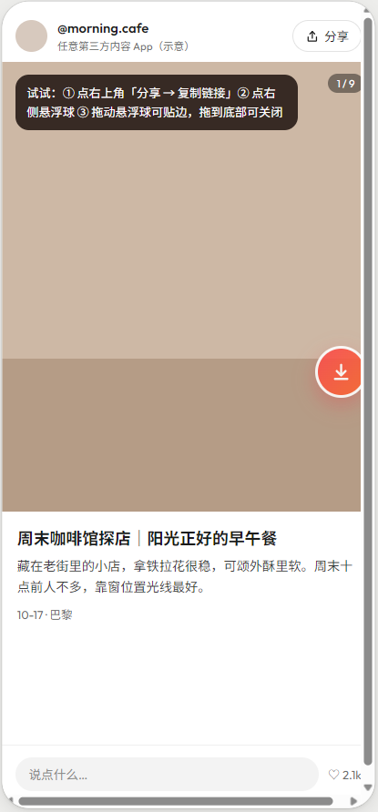
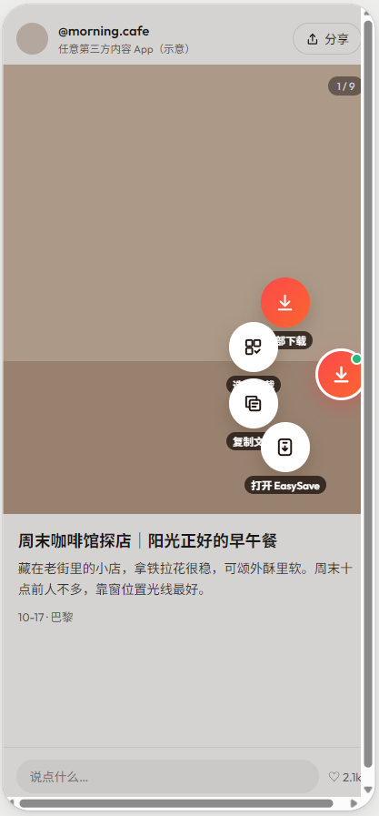
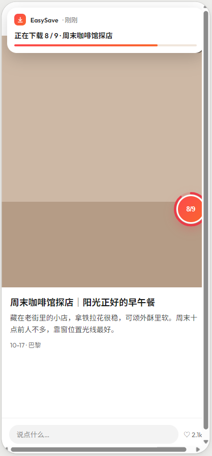
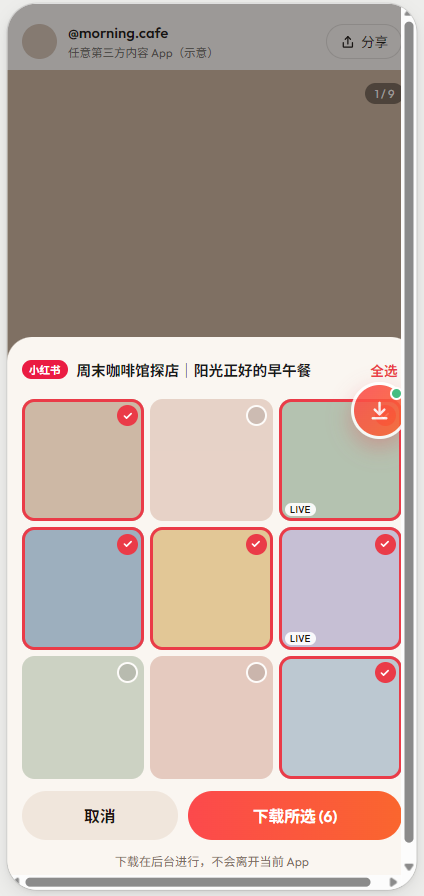
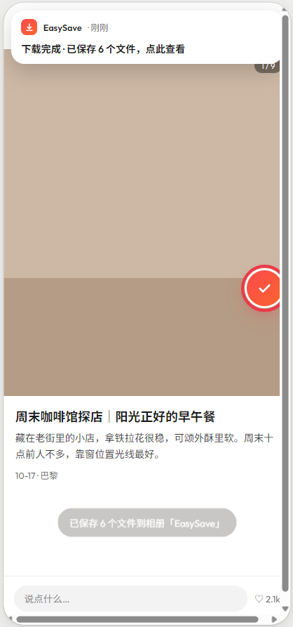

- 定位：一个覆盖在**所有其它 App 之上**的系统级悬浮窗（可选功能，默认关闭，在"我的 → 设置"中开启；开启时引导用户授予"显示在其他应用上层"权限）。悬浮球与前台服务由**原生 Kotlin** 实现，解析/下载复用 App 内同一套解析器与 `DownloadManager`。

#### 2.7.1 悬浮球外观与拖动

- 外形：**渐变色圆形按钮**（复用主按钮渐变 `LinearGradient([#FC494C, #FA662E])`），直径约 56px，中心放 EasySave 图标或"↓"符号，带柔和投影（`cardShadow`）。
- 拖动与吸附：可直接拖动；**松手后吸附到最近的左/右屏幕边缘**，并保留上下位置。
- 闲置态：无操作时**略微透明**（约 80% 不透明度），交互或有内容时恢复不透明。
- 链接提示：**不做**"剪贴板有链接就显示绿点/晃动"（Android 10+ 后台收不到剪贴板变化回调，真机已确认）。改为**仅在点击悬浮球时读取剪贴板**（见 §2.7.2）。

#### 2.7.2 点击与圆形菜单

- 点击行为：先读取剪贴板（通过**短暂打开一个透明页面**读取，读取完成**立即关闭**）。**透明页面必须在获得窗口焦点后再读**（真机 MIUI 上在 `onCreate` 直接读会返回空），读完立即 `finish`。
  - 剪贴板无支持链接：轻提示"先在 App 里复制链接"。
  - 有链接：悬浮球**向屏幕内侧**展开**圆形菜单**（以悬浮球为圆心的扇形/环状布局，逐项带图标 + 文字），同时铺一层**半透明遮罩**（`overlayScrim` `Black54`）；点击菜单外的空白处收起菜单。
- 菜单四项（以当前悬浮球所在边为基准向屏幕内展开）：
  1. **全部下载**：后台解析并下载，**不打开 App 界面**。
  2. **选择下载**：在当前 App 之上弹出选择面板（见 §2.7.3）。
  3. **复制文案**：后台解析后把"标题 + 正文"写入剪贴板，完成后提示。
  4. **打开 EasySave**：唯一启动完整 App 的选项，直接进入该帖子的预览页。

#### 2.7.3 选择下载面板

- 形态：复用**后台服务已有的 Flutter 引擎**，把 **FlutterView 挂到悬浮窗**（`TYPE_APPLICATION_OVERLAY`）显示，圆角卡片（`radiusCard` 24），覆盖在当前 App 之上；**不新建第三个 Flutter 引擎**。首版亦可退化为原生 Kotlin 面板（见 `docs/tasks/v1.6.md` 方案对比）。
- 内容：帖子封面头图（可选）+ **九宫格媒体缩略图**（3 列，圆角 `radiusThumb` 16），每格右上角圆形勾选框（选中红底白勾 `✓`）。
- 顶部/底部：**全选 / 取消全选**入口；底部主按钮"**下载选中（N）**"（红橙渐变胶囊），次按钮"取消"。
- 确认后：关闭面板，转入后台下载，流程同"全部下载"（悬浮球显示进度环 + 通知栏进度）。

#### 2.7.4 进度、完成与错误状态

- 下载进行中：悬浮球显示"**已完成 / 总数**"文字与**环形进度**；同时**通知栏同步进度**。下载中再次点击悬浮球只**提示当前进度，不重复发起**。
- 完成：悬浮球短暂显示 ✓，并提示**保存到哪个相册**（跟随"我的 → 设置"里的相册名）；点击通知进入**历史页**。
- 解析失败（需要登录、链接失效等）：悬浮球呈**错误状态**（如红底感叹号），点击后**打开 App 的对应错误页**（见 §4 错误码）。
- 一致性：以上所有下载都**写入历史记录**，与在 App 内下载完全一致。

#### 2.7.5 关闭区域

- 交互：将悬浮球**拖到屏幕底部的关闭区域**时，关闭区域高亮（红色圆形"✕"）；松手即**关闭悬浮球**，并提示"可在设置中重新开启"。
- 权限联动：用户在系统设置中撤销"显示在其他应用上层"权限后，悬浮球**自动关闭**，"我的 → 设置"里的开关**同步变为关闭**；下次开启时**重新引导授权**。

#### 2.7.6 快捷开关（Quick Settings Tile）

- 名称/图标：`label` = "EasySave 下载"；图标使用**单色线条图标**（系统会自动着色，跟随控制中心主题）。
- 状态：空闲态普通显示；**下载进行中显示为激活状态，副标题显示进度**（`Tile.subtitle`，Android 10+）；无任务时恢复。
- 交互：点击（`onClick`）→ 经透明页面读剪贴板 → 有链接则后台"全部下载"，无链接 Toast"剪贴板里没有可解析的链接"。
- 添加引导：「我的 → 设置 → 快捷入口 → 添加到控制中心」；Android 13+ 直接弹系统确认框，Android 12 及以下显示图文说明。

#### 2.7.7 分享到后台下载

- 该系统分享入口**没有可见界面**（透明 Activity），因此在 UI 规范中不涉及视觉元素；仅约定：出现在系统分享面板的名称是"**EasySave 后台下载**"，与"打开 EasySave"的分享入口并存，且不打断用户当前所在 App。

## 3. 全局状态清单

| 页面 / 组件 | 加载中 | 空状态 | 错误 / 异常状态 |
|---|---|---|---|
| 首页 | 解析中（进度 + 取消） | 暂无历史（"粘贴链接开始第一次保存"） | 见 §4，按错误码给文案 + 按钮 |
| 预览页 | 骨架缩略图（`Shimmer` 或灰色占位） | 帖子无媒体（"该帖子没有可保存的图片/视频"） | 见 §4，按错误码给文案 + 按钮 |
| 下载面板 | 每行进度条 | —（有任务才打开） | 部分失败（失败行标红 + 重试） |
| 历史页 | 本地数据读取中（转圈） | 1. 全局无记录：插图 + 引导 + [去解析] 2. 搜索/筛选无结果："没有找到匹配的记录" + [清除筛选] | 本地文件找不到："已从相册删除"占位 + [重新下载] |
| 统一全屏浏览器 | 媒体文件载入中（居中转圈） | — | 媒体已从相册删除："已从相册删除"占位 + [重新下载] |
| 悬浮球（v1.6） | 下载中（环形进度 + "已完成 / 总数"，通知栏同步） | 剪贴板无支持链接（提示"先在 App 里复制链接"） | 解析失败（错误态，点击进入对应错误页）；"显示在其他应用上层"权限被撤销（自动关闭 + 设置开关同步关闭 + 下次重新引导授权） |
| 我的页 | 登录状态检查中（行内小转圈） | — | 登录过期（warning 行内提示） |

## 4. 错误码 → 文案与操作

与 `spec/parsing.md` 错误模型对应（已补 `TIMEOUT`）。

| 错误码 | 用户文案 | 操作按钮 |
|---|---|---|
| `LOGIN_REQUIRED` | "需要先登录小红书/Instagram" | [去登录]（跳对应平台登录页） |
| `PRIVATE_OR_UNAVAILABLE` | "该帖子不存在、私密或已删除" | [返回首页] |
| `BLOCKED` | "请求被对方限制，请稍后再试" | [重试] |
| `INVALID_PAGE` | "页面内容无法识别，可能已改版" | [重试] [复制诊断信息] |
| `UNSUPPORTED_URL` | "不支持的链接，请粘贴小红书/Instagram 帖子链接" | [重新粘贴] |
| `TIMEOUT`（解析/下载超时） | "网络超时，请检查网络后重试" | [重试] |
| 单文件下载失败 | "第 X 项下载失败"（行内标红） | [单独重试]；不弹整批报错 |

诊断信息内容（roadmap v1.1a）：平台、错误码、链接、App 版本；**严禁包含 cookie 或任何账号信息**。

## 5. 附录：原型截图与规范索引对照表

交互细节与原型截图严格对应，原型文件均位于 [`docs/design/gallery-prototype/`](file:///d:/workspace/IdeaProjects/EasySave/docs/design/gallery-prototype/) 与 [`docs/design/bubble-prototype/`](file:///d:/workspace/IdeaProjects/EasySave/docs/design/bubble-prototype/)。

| 序号 | 截图文件 | 对应组件 / 场景 | 关键规范要点 |
|---|---|---|---|
| 1 | [瀑布流.png](file:///d:/workspace/IdeaProjects/EasySave/docs/design/gallery-prototype/瀑布流.png) | 历史页 - 帖子视图（瀑布流） | 保持封面原始比例；多图张数胶囊 `❐ N` + 底部叠层阴影；视频/Live/GIF 角标；底部暗色渐变遮罩 + 平台标签 + 标题；顶部 34px 小图标工具栏 |
| 2 | [列表.png](file:///d:/workspace/IdeaProjects/EasySave/docs/design/gallery-prototype/列表.png) | 历史页 - 帖子视图（列表） | 左侧本地缩略图（含角标与张数）；右侧仅保留"重新解析"与"打开原帖"小图标按钮；整行点击进入全屏浏览器 |
| 3 | [创作者模式.png](file:///d:/workspace/IdeaProjects/EasySave/docs/design/gallery-prototype/创作者模式.png) | 历史页 - 创作者视图 | 2x2 四宫格聚合封面；作者名 + 平台标签 + "X 帖 · Y 个文件"；点击跳转帖子视图并自动应用作者筛选；隐藏布局切换按钮 |
| 4 | [全部模式.png](file:///d:/workspace/IdeaProjects/EasySave/docs/design/gallery-prototype/全部模式.png) | 历史页 - 全部视图 | 所有媒体打散平铺成连续瀑布流；纯媒体展示，无标题与平台遮罩；隐藏布局切换按钮 |
| 5 | [全屏浏览.png](file:///d:/workspace/IdeaProjects/EasySave/docs/design/gallery-prototype/全屏浏览.png) | 统一全屏浏览器（基础） | 顶部"当前 / 总数"与作者标题；右上角圆形勾选框（与页面同步）；底部横向缩略图条（当前项高亮、已选项标记）；底部[重新解析]、[打开原帖]、[分享] |
| 6 | [全屏浏览_gif.png](file:///d:/workspace/IdeaProjects/EasySave/docs/design/gallery-prototype/全屏浏览_gif.png) | 统一全屏浏览器（GIF） | GIF 自动无限循环播放、静音、**不显示进度条**；点击画面切换暂停/播放；左上角 "GIF" 角标；相册落盘为 mp4 |
| 7 | [全屏浏览_live.png](file:///d:/workspace/IdeaProjects/EasySave/docs/design/gallery-prototype/全屏浏览_live.png) | 统一全屏浏览器（Live 图） | 默认静态展示；左上角 "LIVE" 角标；底部悬浮提示"长按播放实况"；长按播放 motion、松手恢复 |
| 8 | [多选模式_瀑布流.png](file:///d:/workspace/IdeaProjects/EasySave/docs/design/gallery-prototype/多选模式_瀑布流.png) | 瀑布流多选模式 | 长按触发；顶栏替换为"✕ 已选 N 项 全选"；选中项红框 + 右上角对勾；底栏替换为 [分享] 与 [删除] |
| 9 | [多选模式_列表.png](file:///d:/workspace/IdeaProjects/EasySave/docs/design/gallery-prototype/多选模式_列表.png) | 列表多选模式 | 左侧滑出圆形勾选框；右侧操作小按钮隐藏；底栏替换为 [分享] 与 [删除] |
| 10 | [左滑删除.png](file:///d:/workspace/IdeaProjects/EasySave/docs/design/gallery-prototype/左滑删除.png) | 列表左滑删除 | **仅列表行支持左滑**露出红色删除块；瀑布流与"全部"视图禁用左滑手势 |
| 11 | [删除确认面板.png](file:///d:/workspace/IdeaProjects/EasySave/docs/design/gallery-prototype/删除确认面板.png) | 删除确认面板（Modal Bottom Sheet） | 默认仅删除记录（支持 SnackBar 撤销）；可勾选"同时删除相册中的 N 个文件"（默认不勾选，不支持撤销，通过 `MediaStore.createDeleteRequest` 走系统确认） |
| 12 | [排序_类型.png](file:///d:/workspace/IdeaProjects/EasySave/docs/design/gallery-prototype/排序_类型.png) | 排序与分组 | 工具栏图标高亮；按类型分组展示（视频 / Live 图 / GIF / 图片），组标题带数量统计且吸顶 |
| 13 | [搜索.png](file:///d:/workspace/IdeaProjects/EasySave/docs/design/gallery-prototype/搜索.png) | 搜索与筛选 | 展开搜索输入框；按标题和作者实时过滤；页面副文案实时更新统计；生效筛选显示为可清除的小标签 Chip |
| 14 | [外观.png](file:///d:/workspace/IdeaProjects/EasySave/docs/design/bubble-prototype/外观.png) | 悬浮球 - 外观 | 渐变圆形按钮，可拖动，松手吸附最近左/右边缘；闲置略微透明；**不显示剪贴板绿点**（点击时才读剪贴板） |
| 15 | [点击.png](file:///d:/workspace/IdeaProjects/EasySave/docs/design/bubble-prototype/点击.png) | 悬浮球 - 圆形菜单 | 点击读取剪贴板后向屏幕内侧展开四项圆形菜单（全部下载 / 选择下载 / 复制文案 / 打开 EasySave），带半透明遮罩，点空白收起 |
| 16 | [全部下载.png](file:///d:/workspace/IdeaProjects/EasySave/docs/design/bubble-prototype/全部下载.png) | 悬浮球 - 全部下载 | 后台解析下载、不打开 App 界面；悬浮球显示"已完成 / 总数"与进度环；通知栏同步进度 |
| 17 | [选择下载.png](file:///d:/workspace/IdeaProjects/EasySave/docs/design/bubble-prototype/选择下载.png) | 悬浮球 - 选择下载面板 | 当前 App 上层弹出九宫格缩略图（可勾选 + 全选），确认后转入后台下载 |
| 18 | [下载完成.png](file:///d:/workspace/IdeaProjects/EasySave/docs/design/bubble-prototype/下载完成.png) | 悬浮球 - 下载完成 | 悬浮球显示 ✓ 并提示保存到哪个相册；点击通知进入历史页 |

