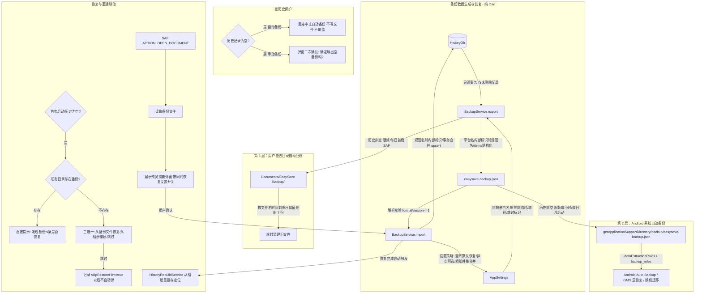

# v1.8 备份与恢复 - 实施计划与任务追踪

本文档追踪 EasySave v1.8"备份与恢复"功能的实施计划与进度，按步骤 ⓪ – ⑥ 组织，附带完整的文件清单、自动化测试清单及真机测试清单。

> **规则约定**：真机测试清单中所有项目必须由用户在真实设备上操作验证。汇报中只有用户明确告知已真机验证的项目才能标记为 `[x] 已验证`，否则保持 `[ ] 待真机验证`。

---

## 1. 架构与实施步骤

---

## 2. 详细实施步骤清单

### 步骤 ⓪：基石与常量共享
- [ ] `app/lib/metadata/provenance_version.dart`：抽取共享常量 `provenanceSpecVersion = '0.1.3'`，供 `metadata` 模块与 `backup` 模块共用，禁止另外硬编码
- [ ] `app/lib/services/history_db.dart`：
  - [ ] `HistoryFile` 实体新增可选字段 `String? relativePath`（如 `"Pictures/EasySave/"`，旧记录未定位前为 `null`）
  - [ ] `HistoryFile.toMap()` / `fromMap()` / `copyWith()` 支持 `relativePath` 序列化与反序列化
  - [ ] 确保旧版 `files_json` 在缺少 `relativePath` 时无缝兼容赋值为 `null`
- [ ] 验证现有单元测试不受影响

### 步骤 ①：纯 Dart 备份与恢复核心 (`BackupService`)
- [ ] `app/lib/services/backup/backup_model.dart`：
  - [ ] 定义 `BackupData`、`BackupPost`、`BackupFile`、`BackupSettings`
  - [ ] 支持 JSON 序列化与反序列化（严格匹配 `spec/backup.md` §2 规范，App 版本为 `"1.8.0"`）
  - [ ] `BackupPost` 包含 `List<Map<String, dynamic>>? items` 结构化对象数组（**禁止嵌套 JSON 字符串**）
  - [ ] `BackupFile` 中 `relativePath` 设为可选 `String?`；Live 图表示遵循 `HistoryFile` 规范：两文件共享相同 `itemIndex`，通过 `mediaType: "image"` 与 `mediaType: "video"` 关联配对
  - [ ] `provenanceSpecVersion` 读取共享常量
  - [ ] 高版本校验：`formatVersion > 1` 抛出 `IncompatibleBackupVersionException`
- [ ] `app/lib/services/backup/backup_service.dart`：
  - [ ] `exportBackup({HistoryDb? db, AppSettings? settings, DateTime? now})`：
    - 在 `HistoryDb` 单个读事务中读取记录，**严格仅导出未删除记录（`where: is_deleted = 0`），绝不导出软删除记录**
    - 平台名转换：使用 v1.7 已有的 `toSpecPlatform()` 将内部标识（`xhs`）转为规范名称（`xiaohongshu`、`instagram`、`x`）
    - 过滤非敏感设置项（白名单模式）；**明确排除** `backupTreeUri`、`lastBackupTime`、`skipRestoreHint`
    - 将 `HistoryRecord.itemsJson` 解析为结构化数组存入 `BackupPost.items`
    - 组装并格式化为标准 JSON 字符串
  - [ ] `importBackup(String jsonStr, {HistoryDb? db, AppSettings? settings, bool restoreSettings = false, bool Function(String)? checkOverlayPermission})`：
    - 解析并校验 `format == "easysave-backup"` 与 `formatVersion <= 1`
    - 平台名转换：使用 `toAppPlatform()` 将规范平台名称转回内部标识（`xiaohongshu` -> `xhs`）
    - 在单个数据库事务中执行合并：按 `(platform, sourceId)` 合并帖子，按 `assetId`（或 `itemIndex + mediaType`）合并文件
    - 用户主动恢复语义：调用 `upsert(..., restoreDeleted: true)`，对于备份时有效但在本地被删除的记录恢复可见
    - 与已有记录冲突时，捕获字段以相册文件现存 XMP 为准
    - 设置恢复策略：
      - 仅在 `restoreSettings == true` 时恢复设置；
      - `usedAlbumNames` 采用**并集合并（Set Union）**，不覆盖已有相册名；列表字段必须使用可变 List（`List<String>.from(...)`）；
      - 若恢复悬浮球为开但当前未授予悬浮窗权限，重置为关闭并记录提示文本；
      - 坚决不覆盖 `backupTreeUri`、`lastBackupTime`、`skipRestoreHint`
  - [ ] `previewBackup(String jsonStr)`：快速解析备份元数据，返回 `BackupPreview`（导出时间、版本、帖子数、文件数、设置摘要），用于弹窗确认
- [ ] `app/lib/services/backup/backup_security.dart`：
  - [ ] 提供敏感键扫描器 `validateNoSensitiveKeys(Map<String, dynamic> jsonMap)`：
    - **仅递归检查 JSON 对象的键名（Keys）**，不检查值（Values）；
    - 匹配 `cookie`, `token`, `session`, `auth`, `authorization`, `password` 等敏感键名；
    - **仅在单元测试中断言，运行时不拦截导出**

### 步骤 ②：自动化单元测试套件
- [ ] `app/test/services/backup_service_test.dart`：
  - [ ] **TC-01: 完整导出与往返一致性测试**
    - 包含多平台（XHS、IG、X）、多文件（图片、视频、Live 图配对、GIF）、含完整来源元数据（provenance）及个性化设置；
    - 验证：导出后清空再导入，帖子数、文件、Live 图配对、`assetId`、`provenance` 逐字段一致。
  - [ ] **TC-01b: 空历史保护单元测试**
    - 验证当历史记录为空时，调用自动备份方法不会写入或覆盖任何文件；
    - 验证本地已存在非空私有备份文件时，空历史不会覆盖它。
  - [ ] **TC-02: 连续导入幂等性测试**
    - 连续两次导入相同备份文件，数据库记录数、文件数保持不变。
  - [ ] **TC-03: 用户主动恢复已删除记录测试**
    - 场景：记录在备份导出时有效；导出后用户在本地软删除（`isDeleted = 1`）；再从该备份恢复 → 该记录成功恢复可见（`isDeleted = 0`）。
  - [ ] **TC-03b: 本地已删除记录不被导出测试**
    - 本地已标记为软删除（`isDeleted = 1`）的记录，执行导出后，生成的 JSON 中不包含该记录。
  - [ ] **TC-04: 平台标识双向映射测试**
    - 导出时内部标识 `xhs` 转换为 `xiaohongshu`；导入后历史库中的平台标识恢复为 `xhs`，与导出前完全一致。
  - [ ] **TC-05: 版本容错与缺字段防御测试**
    - `formatVersion = 2` 时明确抛出 `IncompatibleBackupVersionException` 并拒绝导入；
    - `relativePath` 为 null 的旧记录、`items` 为旧版字符串等低版本兼容数据，验证导入平滑完成并填充合理默认值。
  - [ ] **TC-06: 严格敏感键名（Keys）审计测试**
    - 扫描导出 JSON 的所有对象键名，断言不含 `cookie`, `token`, `session`, `auth`, `authorization`, `password` 等敏感键名；
    - 验证若帖子标题或正文自然包含 "token"、"session" 等词汇，键名测试正常通过，不误报。
  - [ ] **TC-07: 设置恢复与并集合并测试**
    - 历史库为空时默认恢复设置，历史不为空时不恢复设置；
    - 验证勾选恢复设置后，`usedAlbumNames` 采用并集合并，不覆盖已有项，且反序列化后为可变 List；
    - 验证 `backupTreeUri`、`lastBackupTime`、`skipRestoreHint` 绝不被导出和恢复。
  - [ ] **TC-08: 悬浮球权限约束测试**
    - 备份中 `bubbleEnabled: true`；模拟无悬浮窗权限（`checkOverlayPermission` 返回 false）时导入；
    - 断言：`settings.bubbleEnabled` 变为 `false`，并生成授权提示文本。

### 步骤 ③：第 2 层 Android 自动备份
- [ ] Android 备份规则 XML 配置：
  - [ ] `app/android/app/src/main/res/xml/data_extraction_rules.xml`（Android 12+ / API 31+）：仅包含 `files/backup/easysave-backup.json`，排除数据库、shared_prefs、webview、cache 等
  - [ ] `app/android/app/src/main/res/xml/backup_rules.xml`（Android 11 及以下 / API < 31）：仅包含 `backup/easysave-backup.json`
- [ ] `app/android/app/src/main/AndroidManifest.xml`：
  - [ ] 配置 `android:allowBackup="true"`
  - [ ] 配置 `android:dataExtractionRules="@xml/data_extraction_rules"`
  - [ ] 配置 `android:fullBackupContent="@xml/backup_rules"`
- [ ] `app/lib/services/backup/local_auto_backup.dart`：
  - [ ] 使用 `getApplicationSupportDirectory()` 获取私有目录路径 `${supportDir.path}/backup/easysave-backup.json`（禁止用 `../` 拼接）
  - [ ] `scheduleLocalBackup({bool force = false})`：
    - **空历史保护**：若未软删除的历史记录总数为 0，直接跳过，不创建或覆盖任何文件；
    - 限频逻辑：下载完成触发时至少间隔 1 小时；每日冷启动首次运行自动执行
- [ ] 集成点：
  - [ ] `DownloadManager`: 批次完成保存后调用 `scheduleLocalBackup()`
  - [ ] `main.dart`: 启动生命周期中，**先完成"发现私有备份"检查，再调度每日冷启动自动备份**

### 步骤 ④：第 3 层自选文件夹备份与 SAF 平台通道
- [ ] Android 原生 Kotlin 实现 SAF 桥接（`MainActivity.kt` 扩展 `easysave/saf` 渠道）：
  - [ ] `pickDirectory()`: 启动 `ACTION_OPEN_DOCUMENT_TREE`，调用 `takePersistableUriPermission` 持久化读写权限，返回 Tree URI
  - [ ] `pickBackupFile()`: 启动 `ACTION_OPEN_DOCUMENT`（MIME 类型 `application/json`），返回 Document URI
  - [ ] `writeBackupToDirectory(treeUri, fileName, content)`:
    - 检查目录写入权限；若权限失效返回特定错误码 `PERMISSION_LOST`
    - 在目标目录下创建 `DocumentFile` 并写入 JSON 字节
    - **轮转清理**：遍历 `easysave-backup-*.json`，**提取文件名中的时间戳 `YYYYMMDD-HHmm` 降序排序**，严格保留最新的 7 份，更旧的自动删除
  - [ ] `readDocumentContent(documentUri)`: 从 Document URI 读取文本内容
  - [ ] `checkDirectoryAccess(treeUri)`: 检查持久化 URI 是否仍然具备读写权限
- [ ] `app/lib/services/backup/saf_service.dart`：
  - [ ] 对接原生 `easysave/saf` MethodChannel
  - [ ] **空历史保护**：自动备份调度时若历史记录为空直接中止，不向外部文件夹写出空文件；
  - [ ] 优雅处理权限失效（提示重新选择目录，不静默失败）
  - [ ] 自动触发时机与第 2 层一致：批次完成（限频 1 小时）与每日冷启动首批
- [ ] `app/lib/services/settings.dart` 扩展：
  - [ ] 新增 `backupTreeUri`、`lastBackupTime`、`skipRestoreHint`（三个字段均不参与备份）

### 步骤 ⑤：恢复体验与设置页 UI
- [ ] 备份与恢复设置页 (`app/lib/pages/backup_restore_page.dart`)：
  - [ ] 入口：从「我的 → 设置 → 备份与恢复」进入
  - [ ] 界面参考 Mihon 风格：
    - 自动备份开关与目标文件夹选择（展示当前路径，建议默认 `Documents/EasySave Backup`）
    - 上次备份时间卡片（若从未备份显示"从未备份"）
    - "立即备份"操作按钮（**若历史记录为空，弹窗二次确认："当前没有任何记录，确定要导出空备份吗？"**；确认后写出并轮转）
    - "从备份恢复"操作按钮（选择文件并弹出恢复预览）
    - 权限失效醒目警示与一键重新授权引导
- [ ] 恢复预览弹窗 (`app/lib/widgets/restore_preview_sheet.dart`)：
  - [ ] 展示元数据（备份时间、设备应用版本、包含帖子数、媒体文件数、设置摘要）
  - [ ] 提供"同时恢复设置"复选框（**当前历史为空时默认勾选，当前历史不为空时默认不勾选**）
  - [ ] "取消" / "确认恢复"操作
- [ ] 首次启动 / 历史为空引导：
  - [ ] 启动顺序：在冷启动自动备份触发之前先执行检查；
  - [ ] 当历史为空且 `settings.skipRestoreHint != true` 时：
    - **优先检查**：检查私有目录是否存在 `files/backup/easysave-backup.json`；
    - **若存在**：直接弹窗提示"发现 <备份时间> 的备份（N 条记录），是否恢复？" [确认恢复] [跳过]；
    - **若不存在**：展示三选一引导卡片：`[从备份文件恢复]` / `[从相册重建]` / `[跳过]`；
    - **用户点击跳过**：保存 `settings.skipRestoreHint = true`，以后不再自动提示
- [ ] 恢复后联动机制：
  - [ ] 恢复完成后自动调用 `HistoryRebuildService.rebuild()`，全量比对相册，补齐备份后新增下载文件并重新定位 `mediaId`
  - [ ] 弹出 SnackBar 展示恢复统计（恢复帖子数、文件数及悬浮球授权提醒）

### 步骤 ⑥：相册文件定位与 `relativePath` 增强
- [ ] 新下载文件写入：
  - [ ] `Saver.saveToGallery` 在插入相册并查询到 mediaId 后，一并获取其 `relativePath`（例如 `"Pictures/EasySave/"` 或 `"Movies/EasySave/"`）
  - [ ] `DownloadManager.writeBatchHistory` 将 `relativePath` 填入 `HistoryFile` 持久化至 `files_json`
- [ ] 旧记录补写：
  - [ ] `GalleryLocatorService.syncRecord` 在定位命中 asset 时，若原 `file.relativePath` 为空，通过 `MediaHeaderService.queryAlbum(mediaId)` 获取 `relativePath` 并自动补写保存至数据库
- [ ] 跨机恢复回退定位算法 (`GalleryLocatorService.locateAsset`)：
  - [ ] 优先级 1：若 `relativePath` 存在，按 `relativePath + filename` 精确在相册中定位
  - [ ] 优先级 2：若无 `relativePath` 或未命中，在 `usedAlbumNames` 中的各个相册目录遍历匹配 `filename`
  - [ ] 优先级 3：通过 `postId` 进行序列模糊匹配
  - [ ] 匹配成功后刷新本地 `mediaId` 并缓存，同时补写 `relativePath`

---

## 3. 文件变更清单

### 新建文件
| 序号 | 文件路径 | 职责说明 |
|---|---|---|
| 1 | `spec/backup.md` | v1.8 备份与恢复完整规范定义（已按审核意见修改） |
| 2 | `docs/tasks/v1.8.md` | 本实施计划与任务追踪文档（本文件） |
| 3 | `app/lib/metadata/provenance_version.dart` | 提取 `provenanceSpecVersion = '0.1.3'` 共享常量 |
| 4 | `app/lib/services/backup/backup_model.dart` | 备份 JSON 序列化/反序列化数据模型与版本校验 |
| 5 | `app/lib/services/backup/backup_service.dart` | 纯 Dart 备份导出、导入合并、冲突裁决与预览逻辑 |
| 6 | `app/lib/services/backup/backup_security.dart` | 敏感键名（Keys）安全审计与扫描器 |
| 7 | `app/lib/services/backup/local_auto_backup.dart` | 第 2 层本地私有目录自动快照写入器与限频调度器（含空历史保护） |
| 8 | `app/lib/services/backup/saf_service.dart` | 第 3 层与恢复使用的 SAF 原生通道 Dart 封装（含空历史保护） |
| 9 | `app/android/app/src/main/res/xml/data_extraction_rules.xml` | Android 12+ 自动备份与设备迁移包含/排除规则 |
| 10 | `app/android/app/src/main/res/xml/backup_rules.xml` | Android 11- 全量备份包含/排除规则 |
| 11 | `app/lib/pages/backup_restore_page.dart` | 「我的 → 设置 → 备份与恢复」设置管理页 |
| 12 | `app/lib/widgets/restore_preview_sheet.dart` | 从备份恢复确认与预览底栏对话框 |
| 13 | `app/test/services/backup_service_test.dart` | 备份与恢复全量纯 Dart 单元测试套件（含空历史保护测试） |

### 修改文件
| 序号 | 文件路径 | 修改说明 |
|---|---|---|
| 1 | `docs/roadmap.md` | 更新 v1.8 备份与恢复条目详细需求与验收标准（已更新） |
| 2 | `app/android/app/src/main/AndroidManifest.xml` | 配置 allowBackup、dataExtractionRules、fullBackupContent |
| 3 | `app/android/app/src/main/kotlin/com/james/easysave/MainActivity.kt` | 注册 `easysave/saf` 通道，实现目录授权、文件选择、基于时间戳轮转写入与读取 |
| 4 | `app/lib/services/history_db.dart` | `HistoryFile` 扩展可选 `relativePath`；导出仅查未删除记录；导入事务支持 |
| 5 | `app/lib/services/settings.dart` | 扩展 `backupTreeUri`、`lastBackupTime`、`skipRestoreHint`；不可修改集合防护；白名单导出/导入 |
| 6 | `app/lib/services/gallery_locator_service.dart` | 定位成功补写 `relativePath`；跨机恢复按 relativePath + filename 优先查找 |
| 7 | `app/lib/services/saver.dart` | 保存相册后解析并返回真实的 MediaStore `relativePath` |
| 8 | `app/lib/services/download_manager.dart` | 保存 `HistoryFile` 时携带 `relativePath`；下载完成后触发限频本地与外部自动备份 |
| 9 | `app/lib/pages/history_page.dart` | 首次启动/历史为空时先检查本地备份再展示三选一引导卡片 |
| 10 | `app/lib/pages/mine_page.dart` | 设置项列表新增「备份与恢复」入口 |
| 11 | `app/lib/main.dart` | 启动流程中触发每日冷启动自动备份检查（晚于私有备份检查） |

---

## 4. 自动化测试清单

执行命令：`flutter test app/test/services/backup_service_test.dart`

- [ ] **TC-01: 完整导出与往返一致性测试**
  - 构造包含多平台（XHS、IG、X）、多文件（图片、视频、Live 图配对、GIF）、含完整来源元数据（provenance）及个性化设置；
  - 验证：导出后清空再导入，帖子数、文件、Live 图配对、`assetId`、`provenance` 逐字段一致。
- [ ] **TC-01b: 空历史保护测试**
  - 验证当未删除记录总数为 0 时，调用自动备份方法不会写出文件；
  - 验证若本地已存在非空私有备份文件，空历史调用自动备份不会覆盖它。
- [ ] **TC-02: 连续导入幂等性测试**
  - 连续两次导入相同备份文件，数据库记录数、文件数保持不变。
- [ ] **TC-03: 用户主动恢复已删除记录测试**
  - 场景：某条记录在备份导出时有效；导出后用户在本地执行软删除（`isDeleted = 1`）；
  - 执行备份恢复导入；
  - 验证：该记录成功恢复可见（`isDeleted = 0`），符合 `restoreDeleted: true` 规范。
- [ ] **TC-03b: 本地已删除记录不被导出测试**
  - 在本地数据库中先将某条历史记录软删除（`isDeleted = 1`）；
  - 执行 `BackupService.exportBackup()`；
  - 验证：导出的 JSON 数据中不包含该已删除记录。
- [ ] **TC-04: 平台标识双向映射测试**
  - 验证内部标识 `xhs` 在导出时转换为 `xiaohongshu`；
  - 验证导入后写回历史库的 `HistoryRecord.platform` 还原为 `xhs`，与原有历史库标识完全一致。
- [ ] **TC-05: 版本容错与缺字段防御测试**
  - 篡改 JSON 中 `formatVersion = 2`，验证抛出 `IncompatibleBackupVersionException` 并拒绝导入；
  - 传入缺失 `relativePath`（为 null）、`items` 为旧版字符串等低版本兼容数据，验证导入平滑完成并填充合理默认值。
- [ ] **TC-06: 严格敏感键名（Keys）审计测试**
  - 扫描导出 JSON 的所有对象键名，断言不含 `cookie`, `token`, `session`, `auth`, `authorization`, `password` 等敏感键名；
  - 验证若帖子标题或正文自然包含 "token"、"session" 等词汇，键名测试正常通过，不误报。
- [ ] **TC-07: 设置恢复与并集合并测试**
  - 验证历史为空时默认恢复设置，历史不为空时不恢复设置；
  - 验证勾选恢复设置后，`usedAlbumNames` 采用并集合并，不覆盖已有项，且反序列化后为可变 List；
  - 验证 `backupTreeUri`、`lastBackupTime`、`skipRestoreHint` 绝不被导出和恢复。
- [ ] **TC-08: 悬浮球权限约束测试**
  - 备份中 `bubbleEnabled: true`；模拟无悬浮窗权限（`checkOverlayPermission` 返回 false）时导入；
  - 断言：`settings.bubbleEnabled` 变为 `false`，并生成授权提示文本。

---

## 5. 真机测试清单（严格待用户验证）

> **注意**：以下所有真机项目默认状态为 `[ ] 待真机验证`。只有在用户明确告知完成实机测试后，方可在后续报告中更新为已验证。

### 阶段 A：即时备份与设置项验证
- [ ] **FT-01 [待真机验证]** 进入「我的 → 设置 → 备份与恢复」，配置自选文件夹（如 `Documents/EasySave Backup`），确认 SAF 授权弹窗正常展示并成功授权。
- [ ] **FT-02 [待真机验证]** 点击"立即备份"，提示备份成功，目标文件夹中生成 `easysave-backup-YYYYMMDD-HHmm.json`，且界面"上次备份时间"即时更新。若历史为空，弹出二次确认对话框："当前没有任何记录，确定要导出空备份吗？"。
- [ ] **FT-03 [待真机验证]** 连续多次点击立即备份，确认目标文件夹按文件名中的时间戳降序排序，严格保留最近 7 份备份，多余的历史备份文件被自动清理。

### 阶段 B：清除数据与恢复全链路（核心关键验证）
- [ ] **FT-04 [待真机验证]** **灾难恢复全流程验证**：
  1. 手机内先下载小红书（含 Live 图）、Instagram、X 各一条帖子，确认历史页正常显示本地缩略图与 Live 角标；
  2. 进入「备份与恢复」点击"立即备份"导出一份最新备份；
  3. 点击"从备份恢复"，选择该文件，验证**预览弹窗**正确展示帖子数、文件数、备份时间及"同时恢复设置"选项；
  4. 退出 App，在系统「设置 → 应用管理 → EasySave」中执行**清除全部数据**（彻底重置 App）；
  5. 重新打开 EasySave，验证首次启动检查私有目录无自动备份时，正确弹出引导卡片（提供恢复/重建/跳过）；
  6. 点击"从备份文件恢复"，选择之前导出的 JSON 备份文件；
  7. 确认导入完成，历史记录完整恢复，平台名称（小红书/Instagram/X）展示无异常；
  8. 验证系统**自动触发从相册重建历史**，相册内的图片视频成功重新关联并定位，缩略图正常渲染，点击可打开全屏浏览器，Live 图长按正常播放；
  9. 验证 v1.7 修复的"相册名默认列表"：查看设置中用过的相册名列表，确认清除数据后无崩溃且相册列表已被正常加载。

### 阶段 C：系统自动备份与卸载重装恢复验证 (bmgr)
- [ ] **FT-05 [待真机验证]** 先用"立即备份"导出一份到选择的文件夹作为保底 → `adb shell bmgr backupnow com.james.easysave` → 卸载 App → 重新安装 → 打开 App 应直接提示"发现备份（N 条记录），是否恢复？"。
  - *说明*：清除数据不会触发系统恢复，只有重新安装会；该测试依赖设备的系统备份设置（如 GMS 或厂商云服务），系统未恢复文件时记录为环境限制，而不是 App 缺陷。点击"跳过"后，退出重新打开不再弹出引导。

### 阶段 D：安全与权限异常处理
- [ ] **FT-06 [待真机验证]** 在系统设置中撤销对 EasySave 备份文件夹的权限，回到 App 再次点击备份，确认提示"文件夹权限已失效，请重新选择"，不静默失败也不崩溃。
- [ ] **FT-07 [待真机验证]** 备份前开启悬浮球；清除数据后（悬浮窗权限丢失），执行从备份恢复，确认悬浮球开关保持关闭并提示"悬浮球需重新授权后开启"，无强制弹窗骚扰。
